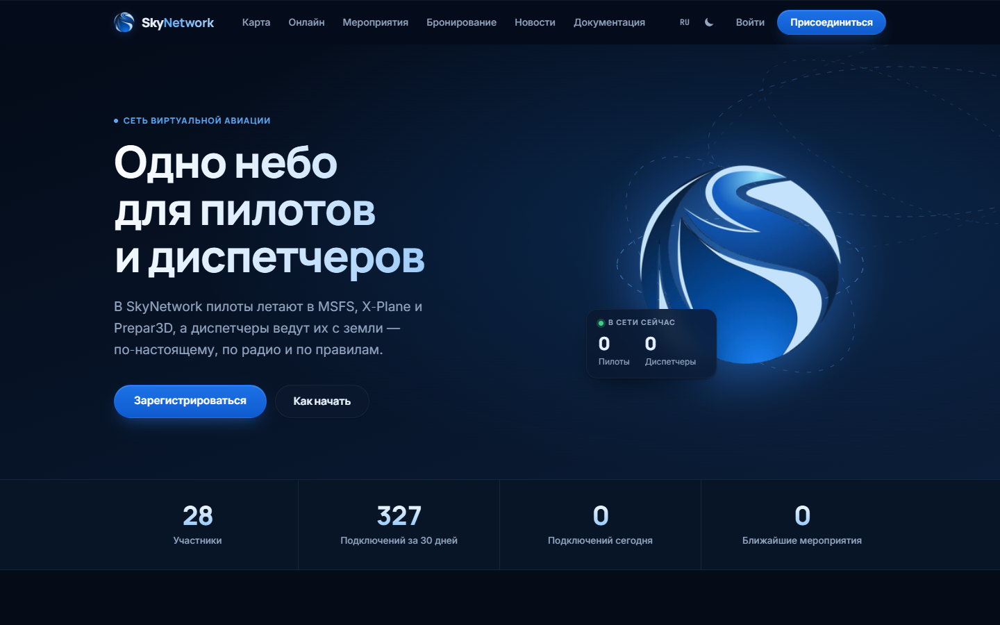
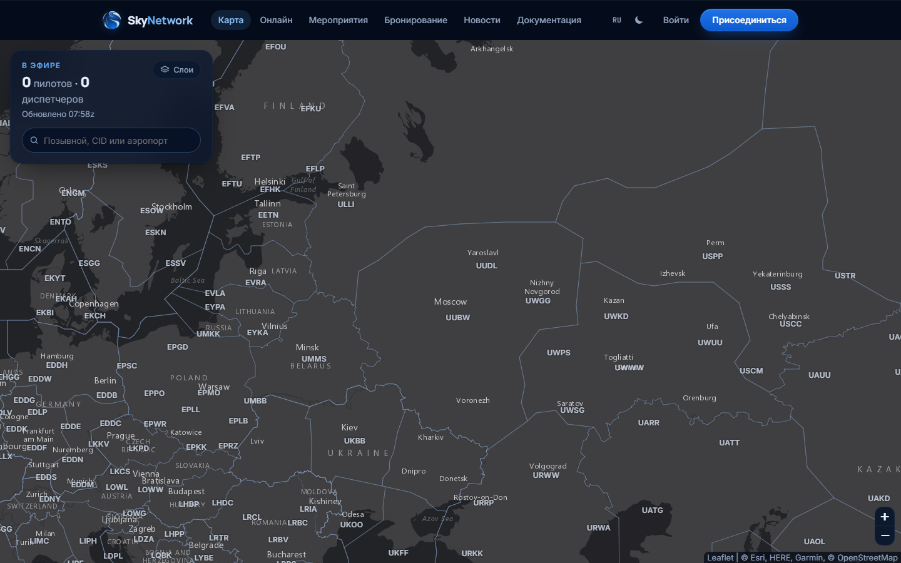
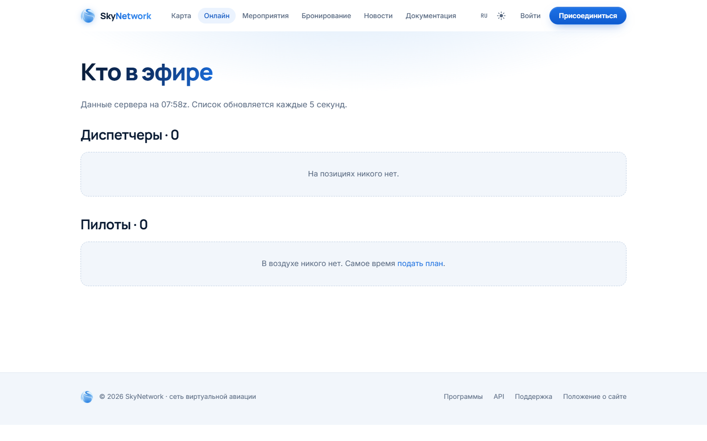

<div align="center">
  
  <h1>SkyNetwork-FSD</h1>
  <p>Сетевой сервер SkyNetwork — FSD-протокол для пилотов и диспетчеров</p>

  [](https://github.com/chatgpt82628163-pixel/SkyNetwork-FSD/actions/workflows/ci.yml)

  [Сайт](https://sky.network.npzy2.us) · [Поддержка](https://sky.network.npzy2.us/support)
</div>

---

## Что это

SkyNetwork-FSD — сетевой сервер для совместных полётов. Он принимает подключения пилотов и диспетчеров по классическому FSD-протоколу, синхронизирует их позиции и переговоры, проверяет учётные данные по общей с сайтом базе SQLite и публикует снимок трафика в формате JSON для сайта.

Сервер написан на C++17 (CMake, OpenSSL, SQLite3) и не имеет внешних сетевых зависимостей во время работы.

---

## Возможности

### Подключения

- Пилоты подключаются по FSD (`#AP`), диспетчеры — по FSD (`#AA`).
- Пароль проверяется по PBKDF2-SHA256-хэшу из базы данных.
- Аккаунты с неподтверждённым e-mail не допускаются на сеть.
- Рейтинг при входе сверяется с базой: диспетчер, указавший более высокий рейтинг, чем есть у него, получает отказ.
- База данных проверяется в фоне каждые N секунд (по умолчанию — 10). Участник, которому на сайте понизили рейтинг или заблокировали аккаунт, отключается немедленно.

### Трафик

- Позиции пилотов (`@N`, `@S`, `@T`) и диспетчеров (`%`) рассылаются в радиусе видимости.
- Позиции диспетчеров с широким охватом (например, центр) видны на всей сети.
- Полётные планы (`$FP`) доставляются диспетчерам в зоне и хранятся на соединении.
- Текстовые сообщения (`#TM`) маршрутизируются по позывному или частоте.

### Диспетчерская координация

- Общие запросы (`$CQ @частота`) рассылаются только другим диспетчерам.
- Хэндофф (`$HO` / `$HA`) — точечный обмен между двумя диспетчерами.

### ATIS

- Сервер автоматически запрашивает ATIS у каждого диспетчера и публикует полученный текст в JSON-ленте.

### Права персонала

| Ранг | Возможности |
|------|-------------|
| SUP  | WHOIS, FIND, STAFF, ONLINE, WARN, KILL (пилоты и ниже) |
| ADM  | Все права SUP + KILL по отношению к SUP |

- `WHOIS` — информация об участнике по позывному или CID; IP показывается только ADM.
- `FIND` — координаты воздушного судна по всей сети.
- `WARN` — отправить предупреждение участнику.
- `KILL` — принудительно отключить с указанием причины (действие записывается в audit_log).
- `STAFF` — список персонала онлайн.
- `ONLINE` — сводка пилотов и диспетчеров.
- Wallop (`#TM*S`) — сообщение всем SUP/ADM онлайн; если никого нет, сервер отвечает об этом.

### JSON-лента данных

Сервер отвечает на `GET /data.json` — снимок всего трафика для сайта:
- позиции пилотов с позывным, координатами, высотой, курсом, скоростью, сквоком;
- список диспетчеров с позывным, частотой, зоной видимости и текстом ATIS.

### Администрирование (skynet-admin)

```
skynet-admin [--db FILE] adduser CID NAME PASSWORD [RATING]
skynet-admin [--db FILE] rating  CID RATING       # OBS S1 S2 S3 C1 C2 C3 I1 I2 I3
skynet-admin [--db FILE] staff   CID RANK          # SUP ADM NONE
skynet-admin [--db FILE] passwd  CID PASSWORD
skynet-admin [--db FILE] suspend CID
skynet-admin [--db FILE] unsuspend CID
```

---

## Скриншоты

<div align="center">
  
  <br><br>
  
  <br><br>
  
</div>

---

## Сборка и запуск

### Зависимости

- CMake ≥ 3.16
- Компилятор с поддержкой C++17
- OpenSSL (libssl-dev / openssl-devel)
- SQLite3 (libsqlite3-dev / sqlite-devel)

На Ubuntu/Debian:

```bash
sudo apt-get install -y libssl-dev libsqlite3-dev
```

### Сборка

```bash
cmake -B build
cmake --build build -j
```

В `build/` появятся `skynet-fsd` и `skynet-admin`.

### Первый запуск

```bash
# Создать тестового участника
./build/skynet-admin --db skynetwork.db adduser 1000001 "Иван Пилотов" пароль

# Запустить сервер
./build/skynet-fsd --db skynetwork.db
```

По умолчанию сервер слушает на порту **6809** (FSD) и **8080** (HTTP-лента).

### Ключи командной строки

| Ключ | По умолчанию | Описание |
|------|-------------|---------|
| `--db FILE` | `skynetwork.db` | Путь к базе данных SQLite |
| `--host ADDR` | `0.0.0.0` | Адрес для прослушивания |
| `--port PORT` | `6809` | FSD-порт |
| `--http-port PORT` | `8080` | Порт HTTP-ленты (`/data.json`) |
| `--name NAME` | `SKYNET` | Имя сервера |
| `--motd TEXT` | `Welcome to SkyNetwork!` | Приветственное сообщение |
| `--account-check N` | `10` | Интервал проверки аккаунтов (секунды) |

### Тесты

```bash
cmake -B build && cmake --build build -j
python3 -m unittest discover -s tests -v
```

Тесты поднимают реальный сервер, создают участников через `skynet-admin` и проверяют FSD-сессии и HTTP-ленту.

---

## Устройство

```
SkyNetwork-FSD/
├── src/
│   ├── main.cpp          # точка входа skynet-fsd, разбор аргументов
│   ├── fsd_server.cpp    # FSD-сервер: event loop, маршрутизация пакетов
│   ├── fsd_server.h      # FsdServer, FsdConfig, Conn, Role
│   ├── accounts.cpp      # SQLite-хранилище аккаунтов, PBKDF2-SHA256
│   ├── accounts.h        # Accounts, Member, рейтинги
│   ├── admin.cpp         # точка входа skynet-admin
│   ├── net.cpp/h         # вспомогательные сетевые функции
│   └── geo.h             # расчёт расстояний между точками
├── tests/
│   └── test_fsd.py       # интеграционные тесты (Python unittest)
├── .github/
│   └── workflows/ci.yml  # CI: сборка + тесты на ubuntu-latest
└── CMakeLists.txt
```

---

## Часть SkyNetwork

SkyNetwork-FSD — один из компонентов экосистемы SkyNetwork.

| Репозиторий | Описание |
|-------------|---------|
| [SkyNetwork-site](https://github.com/chatgpt82628163-pixel/SkyNetwork-site) | Сайт: регистрация, профили, карта трафика |
| [SkyNetwork-FSD](https://github.com/chatgpt82628163-pixel/SkyNetwork-FSD) | Этот репозиторий — сетевой FSD-сервер |
| [Network-ATC](https://github.com/chatgpt82628163-pixel/Network-ATC) | Клиент диспетчера |
| [SkyPilot](https://github.com/chatgpt82628163-pixel/SkyPilot) | Клиент пилота |
| [Skynetwork-voice](https://github.com/chatgpt82628163-pixel/Skynetwork-voice) | Голосовая связь |
| [SkyRUS-site](https://github.com/chatgpt82628163-pixel/SkyRUS-site) | Российский региональный раздел |
| [Skynetwork-bot](https://github.com/chatgpt82628163-pixel/Skynetwork-bot) | Бот уведомлений |

---

## English

**SkyNetwork-FSD** is the network server for the SkyNetwork flight simulation community. It implements the classic FSD protocol for pilot and controller clients, authenticates members against a shared SQLite database (PBKDF2-SHA256 passwords), and serves a live traffic snapshot at `/data.json` for the website.

**Key features:**
- Pilot and controller connections with per-session rating enforcement
- Position broadcasts with proximity filtering; wide-range centre coverage
- Flight plans, frequency-routed text, controller coordination (handoff, shared data)
- Automatic ATIS polling published to the data feed
- Supervisor commands: WHOIS, FIND, WARN, KILL, STAFF, ONLINE
- Account suspension and rating changes take effect within seconds (background polling)
- `skynet-admin` CLI for account management

**Build:**
```bash
# Ubuntu/Debian: sudo apt-get install -y libssl-dev libsqlite3-dev
cmake -B build && cmake --build build -j
python3 -m unittest discover -s tests -v
```

**Links:** [Website](https://sky.network.npzy2.us) · [Support](https://sky.network.npzy2.us/support)
